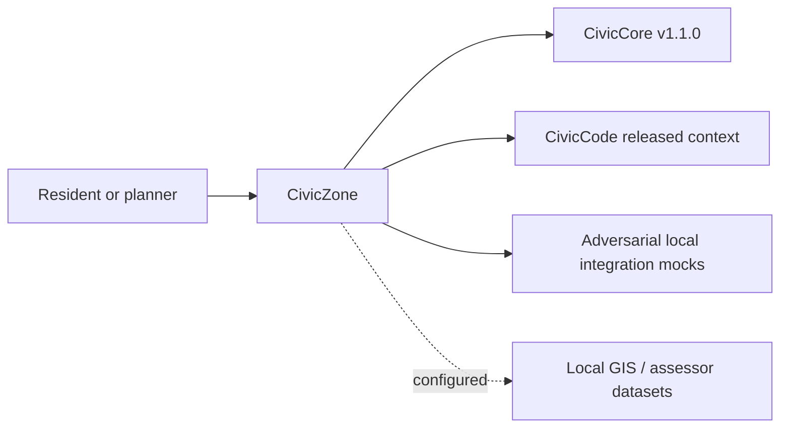

<a id="civiczone-user-manual"></a>

# Townlight Zoning User Manual

## Published connected desktop: 1.4.0-beta.1

This module participates in the signed Townlight Records + Meetings + Code +
Zoning desktop beta published October 21, 2026. Select zoning-beta for all four
products; Records-only remains default and city-core excludes Zoning.
[Download and release limits](https://github.com/townlight/townlight/releases/tag/townlight-records-meetings-code-zoning-v1.4.0-beta.1) ·
[Current operator manual](https://github.com/townlight/townlight/blob/main/USER-MANUAL.md) ·
[Signed acceptance](https://github.com/townlight/townlight/blob/main/docs/installer/townlight-zoning-beta1-signed-acceptance.md).

This is a connected desktop release, not a new standalone package version.
Package/import/API names remain compatibility identifiers. Historical development
checkpoints below retain their original scope; they are superseded for current
desktop publication status. No signed installer or historical evidence is changed.

## Unreleased connected Z4 installer

Townlight desktop1.4.0-1 offers an explicit **Zoning beta** profile alongside
the existing Records and City Core choices. It includes Records, Meetings,
Code and the shared Core/Notice/Access capabilities. Existing selections are
not automatically expanded. The local candidate is unsigned and unpublished.

An authorized staff member opens Zoning, chooses a validated offline GeoJSON
bundle with **Bundle JSON**, and selects **Import parcel dataset**. Lookup
uses the imported jurisdiction and parcel/address. Rules cite authoritative
Code versions; unsupported or conflicting information is disclosed rather than
invented. Staff may record a human answer, select public Meetings context and
create an explicitly public immutable source snapshot. Records can search and
attach that snapshot for its existing human-controlled response workflow.
Attaching a source neither approves nor publishes it. Private notes are not
included in the Records source. Original source and correction history remain.

Use the existing System Health backup/restore and repair controls. Z4's exact
candidate, fresh-install, populated upgrade and recovery evidence is maintained
in the installer acceptance document; this manual does not substitute for it.

## Unreleased connected Z1 boundary

The working branch uses Core 1.2.1 with the existing shared PostgreSQL runtime
and PostGIS. Authorized native city-staff/local-admin accounts can import a
validated offline municipal dataset and look up its real parcel/overlay
context with citations resolved from Townlight Code. Missing data is not
replaced by samples. Imports retain source hashes, actor, version and history.

This developer integration is not a public Zoning release. The Z2 desktop
component is documented below. The legacy sample application below is not
mounted by the connected runtime. See [Z1 import and access details](docs/Z1-OFFLINE-IMPORT.md).

## For Residents And Municipal Decision-Makers

The sections below describe the published v0.2.2 standalone/sample baseline,
not the unreleased connected Z1 runtime described above.

Townlight Zoning answers routine parcel-aware zoning questions with citations. It is not a zoning determination tool, not legal advice, and not a replacement for planner review.

Current state: Townlight Zoning v0.2.2 corrective demotion state. This narrow truth-repair release is no functional upgrade; it exists solely to supersede the false v1.0.0 release from 2026-05-21 in GitHub's Latest impression, with the Townlight Core pin unchanged. The package, health endpoints, canonical zoning schema, Alembic migrations, parcel/zone lookup API, use and dimensional rule APIs, optional database-backed parcel/rule lookup records, resident question ledger records, staff workflow records, citation-grounded resident Q&A, staff-only precedent protection, local adversarial integration mocks, a browser-usable resident UI at `/civiczone`, a staff workflow shell at `/civiczone/staff`, trusted-proxy staff access validation, and Townlight Core v1.1.0 release-wheel dependency alignment exist. Townlight Zoning does not call live external systems by default, does not provide legal advice, and does not make official zoning determinations. See `docs/release-recovery-status.md` for historical recovery context and current release evidence.

The resident UI shows a pre-filled parcel lookup for `123 Main St`, zone context, use and dimensional-rule cards, citation-grounded Q&A, visible loading/success/empty/error/partial state guidance, and planner-escalation guidance. It is informational only: it is not legal advice, not a zoning determination, and not a replacement for municipal planning staff.

## For IT And Technical Staff

Townlight Zoning is a FastAPI Python package pinned to the published Townlight Core v1.1.0 release wheel. The current runtime exposes:

- `GET /`
- `GET /health`
- `GET /civiczone`
- `GET /civiczone/staff`
- Canonical SQLAlchemy models for zones, overlays, parcels, use rules, dimensional rules, citations, precedents, interpretation notes, and zone questions.
- Alembic migration `civiczone_0001_schema`.
- Alembic migration `civiczone_0002_parcel_rules` for optional parcel/rule lookup records.
- Alembic migration `civiczone_0003_question_ledger` for optional resident question ledger records.
- `POST /api/v1/civiczone/parcels/lookup` for sample parcel lookup.
- `POST /api/v1/civiczone/rules/use` for sample use status.
- `POST /api/v1/civiczone/rules/dimensional` for sample dimensional rules.
- `POST /api/v1/civiczone/questions/answer` for citation-grounded sample questions.
- `POST /api/v1/civiczone/planner-review/classify` for sample escalation classification.
- `GET /api/v1/civiczone/staff/precedents/{precedent_id}` for staff-only context.
- `POST /api/v1/civiczone/staff/questions/answer` for staff Q&A with citations.
- `POST /api/v1/civiczone/staff/ambiguity-reviews` and related update/list endpoints.
- `GET /api/v1/civiczone/staff/questions/analytics` for high-volume question analytics.
- `POST /api/v1/civiczone/staff/reports/outline` for staff-report outline support.
- `POST /api/v1/civiczone/staff/flagged-answers` and `/improve` for staff answer review.

Set `CIVICZONE_PARCEL_RULE_DB_URL` to persist parcel, use-rule, dimensional-rule, resident-question ledger, and staff workflow data. Leave it unset for deterministic in-memory sample data during local development and documentation examples.

Staff workflow endpoints require trusted municipal access headers from a configured trusted proxy/source. Local development accepts loopback by default. Shared deployments should set `CIVICZONE_STAFF_TRUSTED_PROXY_CIDRS` and strip client-supplied staff headers before requests reach Townlight Zoning.

- `X-CivicZone-Principal`
- `X-CivicZone-Role: planner`, `staff`, or `zoning_admin`

Resident question text is persisted as raw operational input when the ledger is configured. Do not enter sensitive personal details in sample Q&A, and apply the city's retention/privacy policy before sharing ledger records outside staff operations.

Run local verification with:

```powershell
python -m pip install -e ".[dev]"
python -m pytest -q
bash scripts/verify-release.sh
```

## Architecture



Townlight Zoning depends on Townlight Core and Townlight Code. Townlight Core does not depend on Townlight Zoning.
## Unreleased connected Zoning Z2

The local development branch adds parcel-scoped allowed/conditional/prohibited-use
and dimensional answers bound to actual Townlight Code section, version, effective
date and source identities. Unsupported, conflicting or stale bindings are shown
as needing planner attention, not invented determinations. This is structured
staff-configured lookup, not AI interpretation or legal advice.

The separate Zoning desktop component has resident lookup/question controls and
an authenticated staff workspace: cited rule registration, persisted question
history, planner queue, corrections, basic counts/repeated questions and draft
report outlines. Human corrections do not require an earlier automated flag,
nonempty justification or an extra approval. Original answers and audit history
remain intact. Staff notes/reviews are not included in resident responses.

This is not a released or installed Zoning candidate. The published
Records–Meetings–Code 1.3.0-beta.1 is unchanged. The Z2 operator guide is
zone/docs/Z2-CITED-WORKFLOWS.md.

## Unreleased connected Zoning Z3

Authorized staff can explicitly link a permitted public Meetings archive document
to a Zoning question as hearing context, context or precedent. This is historical
context, not a Code amendment or binding determination. Links retain source IDs,
archive/version identities, content hashes and actor history.

Staff can create a separate immutable Zoning source snapshot and select eligible
snapshots from Records. Staff-only snapshots and private review notes are not
offered as public Records sources. Permissions and content hashes are rechecked
when retrieving or attaching sources; a saved link does not bypass later access
restrictions. Existing stored evidence is preserved rather than rewritten.

Creating or attaching a snapshot does not approve a response or publish anything.
Human corrections remain available without an automatic flag or mandatory
justification. Packaged/installed acceptance and opt-in profile delivery remain
Z4. See zone/docs/Z3-CONNECTED-SOURCES.md. No new public release is claimed.
