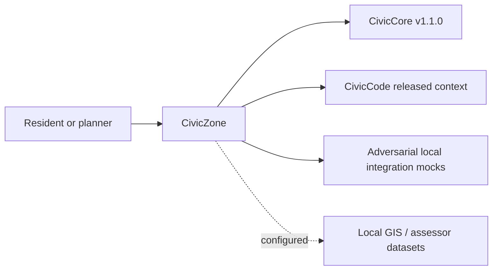

# Townlight Zoning — User manual

## Private beta candidate — 29 October 2026

This guide now includes the local, unpublished corrected candidate. Use `Townlight-beta-corrected-private.msi`, version 1.6.0.1, SHA256 `98bcdef11ebdf5c767f620c904ff49f85115fde3b5c23f62703b111e645aaf86`. Historical public release links below identify earlier compositions; they are not the download instructions for this candidate. The current owned code is AGPL-3.0-only; retain third-party and historical notices.

For the full eight-module desktop choose **Townlight Inspections candidate** (`inspections-preview`) during normal first-run. This profile includes Core, Records, Meetings, Code, Zoning, Planning, Permitting and Inspections, plus supporting Notice and Access. Create the city profile and named administrator, sign in, choose backup storage, and use **Continue without local AI** for the deterministic staff workflows. Run Health Check, then Open Townlight. In System Health use **Finish Records Migration** to activate the canonical Python/PostgreSQL services. Add named staff through Settings. Station is provisioned separately; it does not replace or configure standalone CivicCast.

The private handoff contains the exact candidate identity, per-product receipt matrix and evidence limits. No city data or credentials were used. The tests drive the installed app's native commands and selected real UI controls; this is not a claim that every field, role, vendor or legal workflow has been tested. The source companion accompanying the MSI remains the source for the signed bytes; these later manual edits are a separate documentation companion.

### Zoning operator update

Import the full EPSG:4326 dataset, register exact cited rules, ask a supported parcel question, record staff review and create the chosen snapshot. The existing process explanation accepts an applicable process Code section and resolves its current official public text; unavailable/unrelated authority is reported as unavailable. These explanations remain informational.

Historical published baseline reviewed 2026-10-26; current private-candidate instructions above.

[Product page](https://townlight.github.io/products/zoning/) · [Overall manual](https://github.com/townlight/townlight/blob/main/USER-MANUAL.md) · [Requirements assessment](https://github.com/townlight/townlight/blob/main/docs/assessment/feature-and-integration-review.md)

## Purpose and audience

Zoning supports parcel-aware informational work. It preserves dataset identity, source rules and human corrections, while refusing to turn an answer into a zoning determination or permit approval.

Primary operators: **Planners and authorized land-use staff**. [Release and acceptance notes](https://github.com/townlight/townlight/releases/tag/townlight-records-meetings-code-zoning-v1.4.0-beta.1).

## Before starting

Use the explicit product composition in the installed Townlight desktop. Sign in with the required local staff account, confirm System Health readiness and take a backup before maintenance. If a workspace is absent, inspect the profile and release identity before importing data. Optional AI is not needed for the accepted deterministic workflow. The procedures below use real saved sources; sample/demo web pages are not substitutes.

## Complete the workflow

### 1. Prepare parcel sources

Use the complete documented EPSG:4326 GeoJSON bundle, not a loose geometry file. Check dataset/jurisdiction metadata, parcel identifiers and original hashes. Retain the original and make the import confirmation explicit.

### 2. Import and inspect

Use Import parcel dataset. Review validation results and source provenance. Invalid geometry, unsupported coordinates or incomplete envelopes need source correction before import; do not edit the installed database to force acceptance.

### 3. Configure cited rules

Associate the relevant public Code section/version with the zoning rule. Inspect use, dimensional and overlay context. A missing applicable rule must remain a gap or planner-review issue rather than a fabricated answer.

### 4. Ask and review

Look up the parcel or ask the supported question. Read citations and the non-determination disclaimer. Escalate ambiguity, low confidence or a request for an official determination to a planner.

### 5. Record staff context

Record an explicit human correction and its reason; retain question/event history. Select permitted Meetings history when relevant. Staff-only precedent may support staff work but cannot be copied into a public answer merely by changing an audience label.

### 6. Create a public snapshot

Review the public answer and permitted citations, then create the explicitly public immutable snapshot. Inspect its exact content/hash. The snapshot is informational; no entitlement or zoning determination is created.

### 7. Attach to Records

Select the public snapshot explicitly for an existing request. Records retains its own approval and release controls and rechecks source permissions. Zoning context can also be selected by Planning and Permitting where their provider contracts permit it.

## How this product connects

Zoning consumes Code and permitted Meetings evidence; Planning and Permitting select its public source documents. Records receives its public snapshots.

## Boundaries and known gaps

The accepted installed path uses local GeoJSON/PostGIS. It does not certify every ArcGIS service, assessor import, CKAN publication, question analytics or public-internet deployment in the broader specification.

## Shared operating rules

Use the installed native desktop for the accepted workflow. Standalone package web pages, sample endpoints and developer API examples are different surfaces. A local Resident/Public view is not an internet deployment. Confirm the selected composition before looking for a workspace.

1. Keep named staff accounts and least privilege. Administrators manage setup; ordinary staff use their authorized workspace. Do not put credentials, unredacted evidence or resident data into public issues.
2. Preserve originals and their hashes. Import preview and confirmation are distinct actions. Treat fictional fixtures as fictional; they are not municipal authority.
3. Save before navigating away, closing or signing out. Unsaved drafts are not a durable record. On a conflict, reopen and reconcile; on an unknown result, inspect the saved record before repeating a write.
4. Review the exact revision and audience. A private packet and a public copy are different artifacts. Public text is explicitly edited/reviewed; changing a filename does not sanitize private content.
5. Keep source permission, version and hash checks. If a provider is stopped or a source becomes restricted, retain the draft, restore authorized access and deliberately reselect evidence. Never bypass the check or substitute a sample.
6. Approval, attachment, export and publication are separate actions. No cross-product attachment is an automatic records response, official permit, legal determination or enforcement decision.

## Installation, maintenance and recovery

For this private candidate use the exact installer and checksum above. Verify its publisher signature and handoff before installation; do not infer upgrade compatibility from its version. The public release references describe historical, separately identified compositions.

Complete Setup and normal runtime activation for the selected composition. Optional local AI can be deferred. Use System Health to distinguish stopped, starting, ready and failed dependencies. Wait for readiness before opening a dependent workspace. Use documented Retry controls after recovery; do not repeat business writes to refresh a stale screen.

Back up through the canonical desktop controls before migration or maintenance. Keep the coherent data, document and profile backup and its receipt in protected storage. A source export is not a full backup. Stop dependent services before PostgreSQL maintenance. Restore through the supported controls rather than editing SQL or restoring historical JSON into the active runtime. Uninstall can retain data; backup before uninstalling and inspect the chosen removal options. Never assume uninstall means data deletion.

For an error, retain the message, time, selected profile, installed version and operation; inspect System Health and relevant logs. Use a redacted support bundle. Do not delete the profile, run an arbitrary downgrade or repair prerequisites as a first response. If an installer requests a restart, save work and obtain the operator’s explicit restart decision before proceeding.

## Evidence and scope

The current normal-profile Sandbox acceptance covers first-run, named staff identity, the selected installed product workflows and coherent backup/restore. The handoff matrix links the exact raw receipts and distinguishes earlier unchanged source/media evidence. This is fresh-install acceptance of the identified private candidate; historical upgrades, every screen/role/vendor and city equipment are not certified. See the local beta handoff and current manual index; public documentation below is historical.


## Maintainer and API reference

The following source contracts support these instructions. The historical reference below retains older API/setup details for their original version; it does not override this operating guide or the release acceptance.

- [civiczone/geo_import.py](https://github.com/townlight/zone/tree/main/civiczone/geo_import.py)
- [civiczone/geo_spatial.py](https://github.com/townlight/zone/tree/main/civiczone/geo_spatial.py)
- [civiczone/cited_rules.py](https://github.com/townlight/zone/tree/main/civiczone/cited_rules.py)
- [civiczone/connected_sources.py](https://github.com/townlight/zone/tree/main/civiczone/connected_sources.py)
- [civiczone/main.py](https://github.com/townlight/zone/tree/main/civiczone/main.py)


---

## Historical package/API reference

The material below is retained from the previous manual for historical and developer reference. Version, unreleased, sample, planned and installation claims below describe that earlier document, not current desktop release status. Use the current guide above for operation. Existing detailed API reference remains useful only for the matching package/version.

<a id="civiczone-user-manual"></a>

# Townlight Zoning User Manual

## Published connected desktop: 1.4.0-beta.1

This module participates in the signed Townlight Records + Meetings + Code +
Zoning desktop beta published October 21, 2026. Select zoning-beta for all four
products; Records-only remains default and city-core excludes Zoning.
[Download and release limits](https://github.com/townlight/townlight/releases/tag/townlight-records-meetings-code-zoning-v1.4.0-beta.1) ·
[Current operator manual](https://github.com/townlight/townlight/blob/main/USER-MANUAL.md) ·
[Signed acceptance](https://github.com/townlight/townlight/blob/main/docs/installer/townlight-zoning-beta1-signed-acceptance.md).

This is a connected desktop release, not a new standalone package version.
Package/import/API names remain compatibility identifiers. Historical development
checkpoints below retain their original scope; they are superseded for current
desktop publication status. No signed installer or historical evidence is changed.

## Unreleased connected Z4 installer

Townlight desktop1.4.0-1 offers an explicit **Zoning beta** profile alongside
the existing Records and City Core choices. It includes Records, Meetings,
Code and the shared Core/Notice/Access capabilities. Existing selections are
not automatically expanded. The local candidate is unsigned and unpublished.

An authorized staff member opens Zoning, chooses a validated offline GeoJSON
bundle with **Bundle JSON**, and selects **Import parcel dataset**. Lookup
uses the imported jurisdiction and parcel/address. Rules cite authoritative
Code versions; unsupported or conflicting information is disclosed rather than
invented. Staff may record a human answer, select public Meetings context and
create an explicitly public immutable source snapshot. Records can search and
attach that snapshot for its existing human-controlled response workflow.
Attaching a source neither approves nor publishes it. Private notes are not
included in the Records source. Original source and correction history remain.

Use the existing System Health backup/restore and repair controls. Z4's exact
candidate, fresh-install, populated upgrade and recovery evidence is maintained
in the installer acceptance document; this manual does not substitute for it.

## Unreleased connected Z1 boundary

The working branch uses Core 1.2.1 with the existing shared PostgreSQL runtime
and PostGIS. Authorized native city-staff/local-admin accounts can import a
validated offline municipal dataset and look up its real parcel/overlay
context with citations resolved from Townlight Code. Missing data is not
replaced by samples. Imports retain source hashes, actor, version and history.

This developer integration is not a public Zoning release. The Z2 desktop
component is documented below. The legacy sample application below is not
mounted by the connected runtime. See [Z1 import and access details](docs/Z1-OFFLINE-IMPORT.md).

## For Residents And Municipal Decision-Makers

The sections below describe the published v0.2.2 standalone/sample baseline,
not the unreleased connected Z1 runtime described above.

Townlight Zoning answers routine parcel-aware zoning questions with citations. It is not a zoning determination tool, not legal advice, and not a replacement for planner review.

Current state: Townlight Zoning v0.2.2 corrective demotion state. This narrow truth-repair release is no functional upgrade; it exists solely to supersede the false v1.0.0 release from 2026-05-21 in GitHub's Latest impression, with the Townlight Core pin unchanged. The package, health endpoints, canonical zoning schema, Alembic migrations, parcel/zone lookup API, use and dimensional rule APIs, optional database-backed parcel/rule lookup records, resident question ledger records, staff workflow records, citation-grounded resident Q&A, staff-only precedent protection, local adversarial integration mocks, a browser-usable resident UI at `/civiczone`, a staff workflow shell at `/civiczone/staff`, trusted-proxy staff access validation, and Townlight Core v1.1.0 release-wheel dependency alignment exist. Townlight Zoning does not call live external systems by default, does not provide legal advice, and does not make official zoning determinations. See `docs/release-recovery-status.md` for historical recovery context and current release evidence.

The resident UI shows a pre-filled parcel lookup for `123 Main St`, zone context, use and dimensional-rule cards, citation-grounded Q&A, visible loading/success/empty/error/partial state guidance, and planner-escalation guidance. It is informational only: it is not legal advice, not a zoning determination, and not a replacement for municipal planning staff.

## For IT And Technical Staff

Townlight Zoning is a FastAPI Python package pinned to the published Townlight Core v1.1.0 release wheel. The current runtime exposes:

- `GET /`
- `GET /health`
- `GET /civiczone`
- `GET /civiczone/staff`
- Canonical SQLAlchemy models for zones, overlays, parcels, use rules, dimensional rules, citations, precedents, interpretation notes, and zone questions.
- Alembic migration `civiczone_0001_schema`.
- Alembic migration `civiczone_0002_parcel_rules` for optional parcel/rule lookup records.
- Alembic migration `civiczone_0003_question_ledger` for optional resident question ledger records.
- `POST /api/v1/civiczone/parcels/lookup` for sample parcel lookup.
- `POST /api/v1/civiczone/rules/use` for sample use status.
- `POST /api/v1/civiczone/rules/dimensional` for sample dimensional rules.
- `POST /api/v1/civiczone/questions/answer` for citation-grounded sample questions.
- `POST /api/v1/civiczone/planner-review/classify` for sample escalation classification.
- `GET /api/v1/civiczone/staff/precedents/{precedent_id}` for staff-only context.
- `POST /api/v1/civiczone/staff/questions/answer` for staff Q&A with citations.
- `POST /api/v1/civiczone/staff/ambiguity-reviews` and related update/list endpoints.
- `GET /api/v1/civiczone/staff/questions/analytics` for high-volume question analytics.
- `POST /api/v1/civiczone/staff/reports/outline` for staff-report outline support.
- `POST /api/v1/civiczone/staff/flagged-answers` and `/improve` for staff answer review.

Set `CIVICZONE_PARCEL_RULE_DB_URL` to persist parcel, use-rule, dimensional-rule, resident-question ledger, and staff workflow data. Leave it unset for deterministic in-memory sample data during local development and documentation examples.

Staff workflow endpoints require trusted municipal access headers from a configured trusted proxy/source. Local development accepts loopback by default. Shared deployments should set `CIVICZONE_STAFF_TRUSTED_PROXY_CIDRS` and strip client-supplied staff headers before requests reach Townlight Zoning.

- `X-CivicZone-Principal`
- `X-CivicZone-Role: planner`, `staff`, or `zoning_admin`

Resident question text is persisted as raw operational input when the ledger is configured. Do not enter sensitive personal details in sample Q&A, and apply the city's retention/privacy policy before sharing ledger records outside staff operations.

Run local verification with:

```powershell
python -m pip install -e ".[dev]"
python -m pytest -q
bash scripts/verify-release.sh
```

## Architecture



Townlight Zoning depends on Townlight Core and Townlight Code. Townlight Core does not depend on Townlight Zoning.
## Unreleased connected Zoning Z2

The local development branch adds parcel-scoped allowed/conditional/prohibited-use
and dimensional answers bound to actual Townlight Code section, version, effective
date and source identities. Unsupported, conflicting or stale bindings are shown
as needing planner attention, not invented determinations. This is structured
staff-configured lookup, not AI interpretation or legal advice.

The separate Zoning desktop component has resident lookup/question controls and
an authenticated staff workspace: cited rule registration, persisted question
history, planner queue, corrections, basic counts/repeated questions and draft
report outlines. Human corrections do not require an earlier automated flag,
nonempty justification or an extra approval. Original answers and audit history
remain intact. Staff notes/reviews are not included in resident responses.

This is not a released or installed Zoning candidate. The published
Records–Meetings–Code 1.3.0-beta.1 is unchanged. The Z2 operator guide is
zone/docs/Z2-CITED-WORKFLOWS.md.

## Unreleased connected Zoning Z3

Authorized staff can explicitly link a permitted public Meetings archive document
to a Zoning question as hearing context, context or precedent. This is historical
context, not a Code amendment or binding determination. Links retain source IDs,
archive/version identities, content hashes and actor history.

Staff can create a separate immutable Zoning source snapshot and select eligible
snapshots from Records. Staff-only snapshots and private review notes are not
offered as public Records sources. Permissions and content hashes are rechecked
when retrieving or attaching sources; a saved link does not bypass later access
restrictions. Existing stored evidence is preserved rather than rewritten.

Creating or attaching a snapshot does not approve a response or publish anything.
Human corrections remain available without an automatic flag or mandatory
justification. Packaged/installed acceptance and opt-in profile delivery remain
Z4. See zone/docs/Z3-CONNECTED-SOURCES.md. No new public release is claimed.
